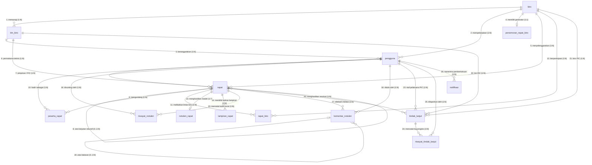

# DOKUMEN PERANCANGAN BASIS DATA: ENTITY RELATIONSHIP DIAGRAM (ERD)
## Sistem Informasi Log & Risalah Rapat (SIM-RAPAT KEK RI)
**Sekretariat Jenderal Dewan Nasional Kawasan Ekonomi Khusus Republik Indonesia**

Dokumen ini memuat spesifikasi lengkap **Entity Relationship Diagram (ERD)** terstandarisasi untuk laporan tugas akhir / skripsi, mencakup seluruh **14 tabel entitas aktif** pada basis data **Neon PostgreSQL** yang terorganisasi dalam **5 Klaster Modul Fungsional**.

---

## 1. Klasifikasi 5 Modul Entitas Basis Data

Untuk mempermudah penjelasan pada sidang / penguji Tugas Akhir, seluruh entitas dikelompokkan ke dalam 5 klaster fungsional yang ternormalisasi (3NF):

```
┌────────────────────────────────────────────────────────────────────────┐
│                        KLASTER BASIS DATA SIM-RAPAT                    │
├──────────────────────────┬─────────────────────────────────────────────┤
│ 1. Organisasi & Akun     │ biro, tim_biro, pengguna                    │
│ 2. Pelaksanaan Rapat     │ rapat, peserta_rapat, penomoran_rapat_biro, │
│                          │ rapat_biro, lampiran_rapat                  │
│ 3. Notulensi & Risalah   │ notulen_rapat, riwayat_notulen,             │
│                          │ komentar_notulen                            │
│ 4. Tindak Lanjut (Action)│ tindak_lanjut, riwayat_tindak_lanjut        │
│ 5. Komunikasi Sistem     │ notifikasi                                  │
└──────────────────────────┴─────────────────────────────────────────────┘
```

---

## 2. Kamus Data Lengkap 14 Entitas Basis Data (Neon PostgreSQL)

### KLASTER 1: ORGANISASI & PENGGUNA

#### 1. Entitas `biro` (Master Biro KEK)
Menyimpan unit kerja eselon tingkat biro di Sekretariat Jenderal Dewan Nasional KEK.
* **`id_biro`** `VARCHAR(50)` **[PK]** : Format identifier unik (contoh: `BIRO-IKK`).
* **`kode_biro`** `VARCHAR(20)` **[UK]** : Kode resmi (`IKK`, `BPPK`, `PKKEK`, `HSDMO`, `UK`).
* **`nama_biro`** `VARCHAR(255)` : Nama lengkap biro.
* **`nama_singkat`** `VARCHAR(100)` : Nama ringkas biro.
* **`deskripsi`** `TEXT` : Tugas pokok dan fungsi biro.
* **`status_aktif`** `BOOLEAN` : Status aktif (`true`/`false`).
* **`dibuat_pada`** `TIMESTAMP` : Waktu pembuatan data.
* **`diperbarui_pada`** `TIMESTAMP` : Waktu pembaharuan data.

#### 2. Entitas `tim_biro` (Tim Kerja di Bawah Biro)
Menaungi unit kerja teknis pelaksana rapat dinas (Tim Investasi, Tim Kerja Sama, Tim Komunikasi).
* **`id_tim`** `VARCHAR(50)` **[PK]** : Format identifier unik (contoh: `TIM-001`, `TIM-002`, `TIM-003`).
* **`id_biro`** `VARCHAR(50)` **[FK]** : Mengacu ke `biro(id_biro)`.
* **`kode_tim`** `VARCHAR(20)` : Kode singkatan tim (`INV`, `KS`, `KOM`).
* **`nama_tim`** `VARCHAR(150)` : Nama resmi tim kerja.
* **`deskripsi_tim`** `TEXT` : Uraian lingkup kerja tim.
* **`status_aktif`** `BOOLEAN` : Status keaktifan tim kerja.
* **`dibuat_pada` / `diperbarui_pada`** `TIMESTAMP`.

#### 3. Entitas `pengguna` (Akun Staf, Notulis, & Administrator)
Menyimpan akun pengguna dan profil aparatur yang bertugas dalam rapat.
* **`id_pengguna`** `VARCHAR(50)` **[PK]** : Format identifier unik (contoh: `USR-001`, `USR-030`).
* **`id_biro`** `VARCHAR(50)` **[FK]** : Mengacu ke `biro(id_biro)`.
* **`id_tim`** `VARCHAR(50)` **[FK, Nullable]** : Mengacu ke `tim_biro(id_tim)`.
* **`nama_lengkap`** `VARCHAR(255)` : Nama pegawai beserta gelar resmi.
* **`email`** `VARCHAR(255)` **[UK]** : Alamat email dinas untuk autentikasi.
* **`kata_sandi`** `VARCHAR(255)` : Hash password terenkripsi.
* **`peran`** `ENUM` : Hak akses sistem (`SUPER_ADMIN`, `ADMIN`, `STAFF`).
* **`status_aktif`** `BOOLEAN` : Status akun aktif.
* **`dibuat_pada` / `diperbarui_pada`** `TIMESTAMP`.

---

### KLASTER 2: PELAKSANAAN RAPAT DINAS

#### 4. Entitas `rapat` (Agenda Rapat Dinas & Sidang Pleno)
Entitas transaksional utama yang mencatat seluruh kegiatan rapat koordinasi dinas.
* **`id_rapat`** `VARCHAR(50)` **[PK]** : Format identifier unik (contoh: `MTG-001`, `MTG-026`).
* **`nomor_rapat`** `VARCHAR(100)` **[UK]** : Nomor resmi registrasi undangan (contoh: `01/INV/2026`).
* **`judul_rapat`** `VARCHAR(255)` : Topik atau agenda rapat.
* **`id_biro`** `VARCHAR(50)` **[FK]** : Biro penyelenggara (mengacu ke `biro(id_biro)`).
* **`id_tim`** `VARCHAR(50)` **[FK, Nullable]** : Tim kerja pemrakarsa (mengacu ke `tim_biro(id_tim)`).
* **`id_pengguna`** `VARCHAR(50)` **[FK, Nullable]** : PIC Rapat / Pimpinan (mengacu ke `pengguna(id_pengguna)`).
* **`id_notulis`** `VARCHAR(50)` **[FK, Nullable]** : Notulis penyusun risalah (mengacu ke `pengguna(id_pengguna)`).
* **`id_rapat_sebelumnya`** `VARCHAR(50)` **[FK, Nullable]** : Relasi rekursif ke `rapat(id_rapat)` untuk sesi lanjutan.
* **`tanggal_rapat`** `DATE` : Tanggal pelaksanaan kegiatan rapat.
* **`waktu_mulai`** `VARCHAR(10)` : Jam mulai (WIB).
* **`waktu_selesai`** `VARCHAR(10)` : Jam selesai (WIB).
* **`lokasi_rapat`** `VARCHAR(255)` : Ruang sidang fisik atau tautan daring.
* **`jenis_rapat`** `VARCHAR(100)` : Bentuk forum (`Rapat Kerja`, `Kunker`, `Audiensi`, dll).
* **`pic_rapat`** `VARCHAR(255)` : Keterangan nama/gelar PIC rapat.
* **`status_rapat`** `ENUM` : Siklus draf risalah (`DRAFT`, `REVIEW`, `APPROVED`, `FINAL`).
* **`status_progres`** `VARCHAR(50)` : Status operasional (`Belum Dimulai`, `Dalam Proses`, `Selesai`).
* **`kategori_naskah`** `VARCHAR(100)` : Klasifikasi naskah masuk (`UNDANGAN_INTERNAL`, `DISPOSISI`, dll).
* **`sub_kategori_naskah`** `VARCHAR(100)` : Sub-klasifikasi naskah.
* **`asal_naskah_masuk`** `VARCHAR(255)` : Asal kementerian / lembaga pemohon rapat.
* **`alasan_penundaan`** `TEXT` : Keterangan jika rapat berstatus ditunda.
* **`dibuat_pada` / `diperbarui_pada`** `TIMESTAMP`.

#### 5. Entitas `peserta_rapat` (Daftar Hadir & Undangan Internal)
Tabel asosiatif (Many-to-Many) antara `rapat` dan `pengguna`.
* **`id_peserta`** `VARCHAR(50)` **[PK]** : Identifier unik record peserta.
* **`id_rapat`** `VARCHAR(50)` **[FK]** : Mengacu ke `rapat(id_rapat)`.
* **`id_pengguna`** `VARCHAR(50)` **[FK]** : Mengacu ke `pengguna(id_pengguna)`.
* **`status_kehadiran`** `ENUM` : Status presensi (`INVITED`, `PRESENT`, `ABSENT`, `EXCUSED`).
* **`dibuat_pada`** `TIMESTAMP`.
* *Constraint*: `UNIQUE(id_rapat, id_pengguna)` mencegah duplikasi nama peserta pada satu rapat.

#### 6. Entitas `lampiran_rapat` (Dokumen & Berkas Rapat)
Menyimpan berkas naskah surat undangan resmi, materi paparan PPT/PDF, dan dokumen pendukung.
* **`id_lampiran`** `VARCHAR(50)` **[PK]** : Identifier unik lampiran.
* **`id_rapat`** `VARCHAR(50)` **[FK]** : Mengacu ke `rapat(id_rapat)`.
* **`nama_berkas`** `VARCHAR(255)` : Nama file dokumen asli.
* **`url_berkas`** `TEXT` : URL penyimpanan file (Object Storage / Cloud Bucket).
* **`ukuran_berkas`** `INTEGER` : Ukuran file dalam satuan bytes.
* **`tipe_berkas`** `VARCHAR(50)` : Format MIME file (PDF, DOCX, PPTX).
* **`nama_pengunggah`** `VARCHAR(255)` : Staf yang mengunggah berkas.
* **`kategori`** `VARCHAR(50)` : Kategori dokumen (`INVITATION`, `MATERIAL`, `CATEGORY_DOC`).
* **`dibuat_pada`** `TIMESTAMP`.

#### 7. Entitas `penomoran_rapat_biro` (Generator Sequence Nomor Urut Rapat)
Generator urutan counter nomor registrasi surat rapat.
* **`id_penomoran`** `VARCHAR(50)` **[PK]** : Identifier generator.
* **`id_biro`** `VARCHAR(50)` **[FK, UK]** : Mengacu ke `biro(id_biro)`.
* **`nomor_terakhir`** `INTEGER` : Nilai counter angka terakhir.
* **`dibuat_pada` / `diperbarui_pada`** `TIMESTAMP`.

#### 8. Entitas `rapat_biro` (Keterlibatan Lintas Biro)
Tabel relasi asosiatif bila rapat bersifat gabungan antar-biro di KEK.
* **`id_rapat`** `VARCHAR(50)` **[PK, FK]** : Mengacu ke `rapat(id_rapat)`.
* **`id_biro`** `VARCHAR(50)` **[PK, FK]** : Mengacu ke `biro(id_biro)`.

---

### KLASTER 3: NOTULENSI & TELAAH RISALAH

#### 9. Entitas `notulen_rapat` (Naskah Risalah Resmi)
Dokumen resmi hasil kesepakatan dan pembahasan rapat dinas.
* **`id_notulen`** `VARCHAR(50)` **[PK]** : Identifier unik risalah.
* **`id_rapat`** `VARCHAR(50)` **[FK, UK]** : Relasi 1-to-1 dengan `rapat(id_rapat)`.
* **`agenda_pembahasan`** `JSONB` : Butir-butir pokok bahasan sidang.
* **`hasil_pembahasan`** `JSONB` : Uraian dinamika pembahasan rapat.
* **`poin_keputusan`** `JSONB` : Ketetapan dan kesepakatan final sidang.
* **`kesimpulan`** `JSONB` : Ringkasan penutup dan legalitas naskah.
* **`dibuat_pada` / `diperbarui_pada`** `TIMESTAMP`.

#### 10. Entitas `riwayat_notulen` (Audit Log Snapshot Revisi Notula)
Mencatat rekam jejak versi naskah setiap kali dilakukan revisi oleh notulis/tim perumus.
* **`id_riwayat`** `VARCHAR(50)` **[PK]** : Identifier snapshot riwayat.
* **`id_rapat`** `VARCHAR(50)` **[FK]** : Mengacu ke `rapat(id_rapat)`.
* **`id_pengguna`** `VARCHAR(50)` **[FK, Nullable]** : User penyunting.
* **`tipe_perubahan`** `VARCHAR(50)` : Jenis aksi (`CREATED`, `UPDATED`, `STATUS_CHANGED`).
* **`nama_kolom`** `VARCHAR(100)` : Bidang yang diubah.
* **`nilai_lama`** `JSONB` : Konten naskah sebelum diubah.
* **`nilai_baru`** `JSONB` : Konten naskah setelah diubah.
* **`ringkasan_perubahan`** `TEXT` : Keterangan revisi.
* **`dibuat_pada`** `TIMESTAMP`.

#### 11. Entitas `komentar_notulen` (Kolaborasi & Review Naskah)
Menyimpan komentar, telaah, dan koreksi staf per paragraf naskah notulensi.
* **`id_komentar`** `VARCHAR(50)` **[PK]** : Identifier komentar.
* **`id_rapat`** `VARCHAR(50)` **[FK]** : Mengacu ke `rapat(id_rapat)`.
* **`id_pengguna`** `VARCHAR(50)` **[FK, Nullable]** : Staf pemberi masukan.
* **`id_induk`** `VARCHAR(50)` **[FK, Nullable]** : Self-referencing untuk thread balasan komentar.
* **`isi_komentar`** `TEXT` : Pesan komentar telaah.
* **`seksi`** `VARCHAR(50)` : Bagian risalah (`agenda`, `discussion`, `decisions`).
* **`sudah_diselesaikan`** `BOOLEAN` : Status koreksi diselesaikan (`true`/`false`).
* **`diselesaikan_oleh`** `VARCHAR(255)` : Nama yang menyelesaikan koreksi.
* **`diselesaikan_pada`** `TIMESTAMP`.
* **`dibuat_pada` / `diperbarui_pada`** `TIMESTAMP`.

---

### KLASTER 4: TINDAK LANJUT & MONITORING (ACTION ITEMS)

#### 12. Entitas `tindak_lanjut` (Butir Tugas & Resolusi Hasil Rapat)
Menyimpan butir mandat tindak lanjut yang wajib dieksekusi oleh tim kerja dan staf PIC.
* **`id_tindak_lanjut`** `VARCHAR(50)` **[PK]** : Identifier tugas tindak lanjut.
* **`id_rapat`** `VARCHAR(50)` **[FK]** : Mengacu ke `rapat(id_rapat)`.
* **`judul_tindakan`** `VARCHAR(255)` : Pokok tugas tindak lanjut.
* **`deskripsi_tindakan`** `TEXT` : Uraian detail instruksi pimpinan.
* **`id_biro`** `VARCHAR(50)` **[FK]** : Biro penanggung jawab (mengacu ke `biro(id_biro)`).
* **`id_tim`** `VARCHAR(50)` **[FK, Nullable]** : Tim penanggung jawab (mengacu ke `tim_biro(id_tim)`).
* **`id_pengguna`** `VARCHAR(50)` **[FK, Nullable]** : Staf PIC pelaksana (mengacu ke `pengguna(id_pengguna)`).
* **`tenggat_waktu`** `DATE` : Batas akhir eksekusi (deadline).
* **`status_tindak_lanjut`** `ENUM` : Status (`PENDING`, `IN_PROGRESS`, `COMPLETED`, `OVERDUE`).
* **`skala_prioritas`** `ENUM` : Tingkat urgensi (`LOW`, `MEDIUM`, `HIGH`, `URGENT`).
* **`diselesaikan_pada`** `TIMESTAMP, Nullable` : Waktu penyelesaian tugas.
* **`dibuat_pada` / `diperbarui_pada`** `TIMESTAMP`.

#### 13. Entitas `riwayat_tindak_lanjut` (Log Progres & Bukti Eksekusi Tugas)
Audit trail perkembangan penyelesaian tindak lanjut oleh PIC.
* **`id_riwayat`** `VARCHAR(50)` **[PK]** : Identifier log progres.
* **`id_tindak_lanjut`** `VARCHAR(50)` **[FK]** : Mengacu ke `tindak_lanjut(id_tindak_lanjut)`.
* **`id_pengguna`** `VARCHAR(50)` **[FK, Nullable]** : Staf yang melaporkan progres.
* **`status_sebelumnya`** `ENUM, Nullable` : Status awal sebelum update.
* **`status_terbaru`** `ENUM` : Status baru setelah update.
* **`catatan_progres`** `TEXT` : Uraian hasil kegiatan yang telah dilakukan.
* **`persentase_progres`** `INTEGER` : Persentase penyelesaian (0 - 100%).
* **`dibuat_pada`** `TIMESTAMP`.

---

### KLASTER 5: KOMUNIKASI & NOTIFIKASI

#### 14. Entitas `notifikasi` (Pemberitahuan Sistem)
Menyampaikan pengingat jadwal rapat, undangan, dan penugasan tindak lanjut kepada staf.
* **`id_notifikasi`** `VARCHAR(50)` **[PK]** : Identifier notifikasi.
* **`id_pengguna`** `VARCHAR(50)` **[FK, Nullable]** : Pengguna penerima notifikasi.
* **`judul`** `VARCHAR(255)` : Judul notifikasi.
* **`pesan`** `TEXT` : Isi ringkasan pemberitahuan.
* **`tipe`** `VARCHAR(50)` : Jenis notifikasi (`meeting`, `action_item`, `system`).
* **`tautan`** `VARCHAR(255)` : Link URL tujuan langsung.
* **`sudah_dibaca`** `BOOLEAN` : Status baca (`false` = baru).
* **`dibuat_pada`** `TIMESTAMP`.

---

## 3. Diagram Relasi Entitas (ERD Notasi Chen / Crow's Foot)

Diagram berikut memodelkan seluruh relasi antar entitas yang saling terhubung di database:



---

## 4. Kaidah Normalisasi Basis Data (Derajat 3NF)

Seluruh 14 tabel di atas telah memenuhi kriteria **Normal Form Ketiga (3NF)**:
1. **1NF (First Normal Form)**: Setiap kolom memiliki nilai tunggal (*atomic value*), tidak terdapat grup nilai berulang, dan setiap tabel memiliki Primary Key unik.
2. **2NF (Second Normal Form)**: Seluruh tabel telah 1NF dan seluruh atribut bukan kunci (*non-prime attributes*) bergantung penuh (*fully functional dependent*) pada Primary Key, bukan pada sebagian kunci komposit.
3. **3NF (Third Normal Form)**: Tidak ada ketergantungan transitif (*transitive dependency*) di mana atribut non-kunci bergantung pada atribut non-kunci lainnya. Relasi dipisahkan secara elegan ke tabel referensi (`tim_biro`, `biro`, `pengguna`).
